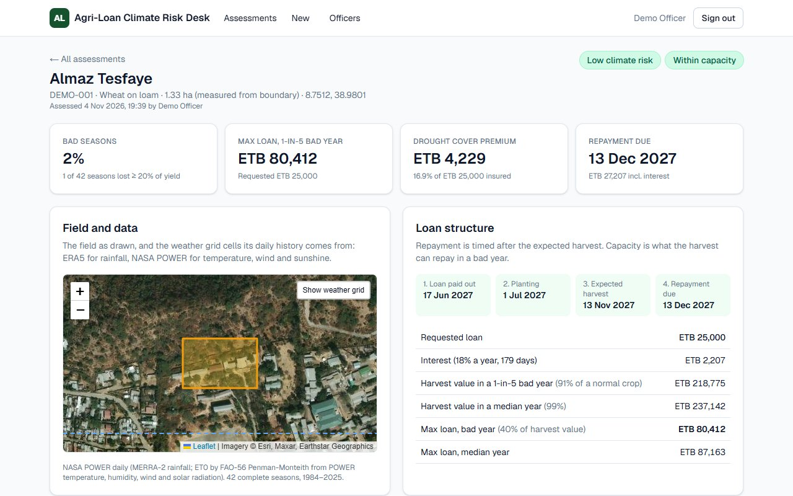
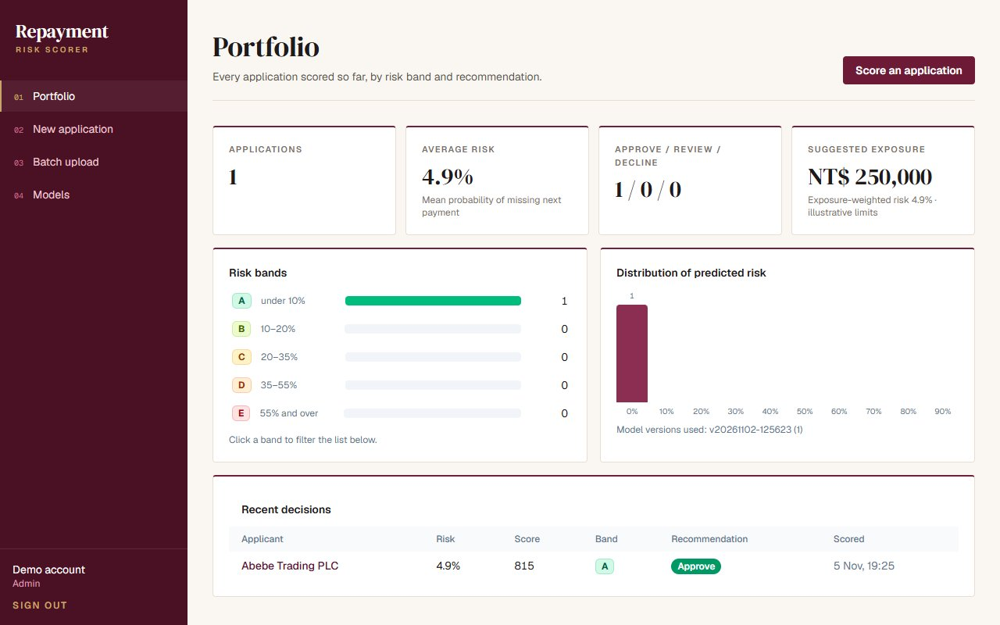
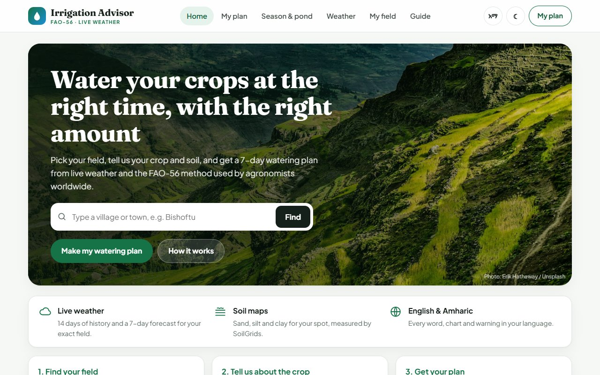

<h1 align="center">Hi, I'm Ephratha Samuel</h1>

  <b>Full-stack developer.</b> I build complete web apps, from the interface to the database, and ship them live. 
  Lately: data and machine learning for lending and farming, each project deployed with a demo you can try.

  

---

## Featured work

<table>
  <tr>
    <td width="33%" valign="top">
      
      <h3>Agri-Loan Climate Risk Desk</h3>
      A loan officer draws a farm on satellite imagery; the desk replays 42 seasons of weather for it and returns climate risk, a repayable loan size and a priced drought insurance design.
        
      <code>FastAPI</code> <code>Next.js</code> <code>PostgreSQL</code> <code>Docker</code> <code>GIS</code>
        
      <a href="https://agri-loan-desk.vercel.app"><b>Live demo</b></a> · <a href="https://github.com/ephrathasamuel/agri-loan-desk"><b>Code</b></a>
    </td>
    <td width="33%" valign="top">
      
      <h3>Repayment Risk Scorer</h3>
      Explainable credit scoring: a LightGBM model (AUC 0.79) scores borrowers from repayment history and shows the factors behind every score, with a model registry and audit trail.
        
      <code>LightGBM</code> <code>SHAP</code> <code>FastAPI</code> <code>Next.js</code> <code>PostgreSQL</code>
        
      <a href="https://repayment-risk-scorer.vercel.app"><b>Live demo</b></a> · <a href="https://github.com/ephrathasamuel/repayment-risk-scorer"><b>Code</b></a>
    </td>
    <td width="33%" valign="top">
      
      <h3>Irrigation Advisor</h3>
      Watering plans for farmers from live weather and the FAO-56 method, plus a season water budget and storage-pond sizing. In English and Amharic.
        
      <code>Python</code> <code>Flask</code> <code>NASA POWER</code> <code>SoilGrids</code>
        
      <a href="https://irrigation-advisor-ca3x.vercel.app"><b>Live site</b></a> · <a href="https://github.com/ephrathasamuel/irrigation-advisor"><b>Code</b></a>
    </td>
  </tr>
</table>

<table>
  <tr>
    <td width="50%" valign="top">
      
      <h3>Halo</h3>
      A marketplace for booking studios, renting production gear and hiring film crews. Separate areas for customers, providers and admins, Google sign-in, and every booking rule checked on the server.
        
      <code>Next.js</code> <code>React</code> <code>Tailwind</code> <code>Supabase</code> <code>PostgreSQL</code>
        
      <a href="https://halo-seven-orcin.vercel.app"><b>Live site</b></a> · <a href="https://github.com/ephrathasamuel/Halo"><b>Code</b></a>
    </td>
    <td width="50%" valign="top">
      
      <h3>Addis Eats</h3>
      Food ordering for a restaurant in Addis Ababa: online payments with Chapa, kitchen and courier boards, a live delivery map and push notifications for every order stage.
        
      <code>Next.js</code> <code>React</code> <code>Supabase</code> <code>Chapa API</code> <code>Web Push</code>
        
      <a href="https://addis-eats-project-taupe.vercel.app"><b>Live site</b></a> · <a href="https://github.com/ephrathasamuel/Addis-Eats-Project"><b>Code</b></a>
    </td>
  </tr>
</table>

| Project | What it is | Tech |
|---|---|---|
| [**Phundz**](https://github.com/ephrathasamuel/Phudz) | Cash-out API for a dollar-backed USDC wallet paying out to M-Pesa: rate quotes locked for 60 seconds, a ledger that holds funds, webhook checks | TypeScript, Fastify, PostgreSQL, Docker |
| [**P-learn**](https://github.com/ephrathasamuel/P-learn-AI) | A learning platform that reads uploaded PDF and Word documents | React, TypeScript, Vite |
| [**Recipe Browser**](https://github.com/ephrathasamuel/flutter-recipe-browser) | Browse and search recipes from TheMealDB API, with a Material 3 UI | Flutter, Dart |
| [**KidCare**](https://github.com/ephrathasamuel/care-track-system) | Team project: a child care app for parents and teachers to track attendance, health records and events | Flutter, Firebase |

---

## Currently

- Building data-driven tools with **Python, FastAPI and machine learning** (LightGBM, SHAP), with **Next.js** front ends
- Deploying on **Docker, Render, Neon and Vercel**, with tests and CI on every push
- Exploring Big Data, climate and agricultural data, and networking (Cisco)
- Looking to collaborate on real-world applications

Fun fact: you thought I was gonna tell you :')
